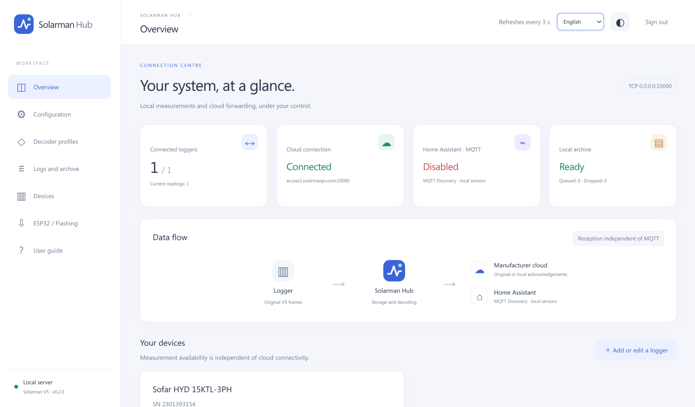

# Solarman Hub



**Solarman Hub — незалежний аматорський проєкт. Він не пов’язаний із SOFAR (SofarSolar).**

[English](../../README.md) · [Polski](pl.md) · [Deutsch](de.md) · [Français](fr.md) · [Čeština](cs.md) · [Slovenčina](sk.md) · [Lietuvių](lt.md) · [Українська](uk.md) · [Русский](ru.md)

Solarman Hub підключає ваш логер Solarman V5 до хмари виробника та водночас надає вимірювання локально. У вебпанелі можна переглядати поточні показники й графіки, зберігати історію, керувати профілями декодування та підключити Home Assistant через MQTT. Панель і посібник доступні дев’ятьма мовами.

Вбудований профіль Sofar HYD G3 / LSW3 декодує 48 полів вимірювань. Іншим форматам потрібен сумісний, незалежно перевірений профіль. Пересилання триває, навіть якщо звіт неможливо декодувати.

## Виберіть спосіб встановлення

| Середовище | З чого почати |
|---|---|
| Linux із Docker Engine і Compose v2 | Швидкий початок нижче |
| Proxmox VE | [Покроковий посібник: VM Debian 13 + Docker](../proxmox/uk.md) |
| Python 3.12+ без Docker | [Посібник користувача](../../src/solarman_hub/guides/uk.md) |

Для Proxmox почніть із VM Debian 13, 2 vCPU, 2 GB RAM і диска 20 GB. Зарезервуйте її адресу LAN та ввімкніть автоматичний запуск. Для довшої історії виділіть більше місця на диску.

[Зміна сервера логера: покрокова інструкція, зокрема для прихованої сторінки налаштувань.](../../src/solarman_hub/guides/uk.md)

**[Автоматичне встановлення VM](../proxmox/uk.md)**

Виконайте цю команду як **root у Shell вузла Proxmox**, а не всередині VM. Майстер проведе вас крок за кроком. Перед підтвердженням перевірте підсумок.

```sh
bash -c "$(wget -qLO - https://raw.githubusercontent.com/ordigital/solarman-hub/main/scripts/proxmox-vm.sh)"
```

## Швидкий початок із Docker

Якщо Docker Engine і Compose v2 вже встановлені:

```sh
git clone https://github.com/ordigital/solarman-hub.git
cd solarman-hub
docker compose up -d --build --wait --wait-timeout 120
docker compose exec hub solarman-hub token --data-dir /data
```

Запускайте команди Docker із достатніми правами, додаючи `sudo`, якщо цього потребує ваша інсталяція.

Відкрийте `http://SERVER_IP:8080`, використовуючи IP хоста Docker або VM. Увійдіть із показаним токеном, додайте числовий **серійний номер логера**, виберіть профіль, збережіть і застосуйте. Потім спрямуйте віддалену TCP-адресу логера на той самий IP хоста і порт `10000`. Нові інсталяції не приймають невідомі логери. Адреса VM відрізняється від адреси керування Proxmox. Токен не змінюється після перезапуску чи оновлення, поки зберігається том даних.

Конфігурація, токени та історія зберігаються в томі Docker, змонтованому в `/data`. Обліковий запис Solarman, cookies і пароль Wi-Fi не потрібні. MQTT використовує адресу й облікові дані вашого брокера, а не токен API Home Assistant.

Інструкції для власних портів і наявних інсталяцій, створених через `docker run`, наведено в посібнику.

## Робота та документація

[Повний посібник користувача](../../src/solarman_hub/guides/uk.md) · [Розгортання Proxmox](../proxmox/uk.md) · [Розробка](../DEVELOPMENT.md) · [Архітектура](../ARCHITECTURE.md) · [Аудит і обмеження](../AUDIT.md)

Посібник також доступний у панелі. Він охоплює пересилання до хмари, локальні підтвердження, MQTT, історію, профілі та налаштування ESP32.

**Звіти, підтверджені локально під час збою, пізніше не завантажуються до хмарної історії.** Обмеження сховища також можуть призвести до прогалин у локальній історії. Зупинка Hub перериває пересилання. Тримайте порти керування та логера в довіреній LAN або VPN.

## Необов’язковий ESP32 Companion

[Джерела](../../firmware/esp32-companion) · [Прошивка USB/OTA та контрольні суми](../../firmware/esp32-companion/dist)

Companion може приймати й пересилати звіти V5, захоплювати трафік Wi-Fi та експортувати профілі декодування. Він працює на класичному ESP32 із 4 MB flash і має англомовний інтерфейс. ESP32 необов’язковий: Hub працює без нього.

Відкрийте **ESP32 / Прошивання** в Hub, щоб завантажити прошивку та знайти інструкції USB/OTA. Заводське прошивання може скинути налаштування плати. У Proxmox спочатку передайте USB-пристрій плати до VM.

Профілі, створені з невідомих звітів, потрібно перевірити вручну. Companion не може визначити електричні вимірювання з довільних байтів або автоматично розшифрувати трафік Wi-Fi.

[♡ Buy me a coffee](https://buymeacoffee.com/adamstrad)
